# 2611COMP101904 - Lập trình Windows

**Họ và tên:** KayTy  
**MSSV:** 51.01.104.097  
**Lớp:** 51.CNTT.B  

---

# LAB 03 - QUẢN LÝ SINH VIÊN BẰNG OOP

## 1. Giới thiệu

Chương trình Console được xây dựng bằng C#, áp dụng các nguyên lý Lập trình hướng đối tượng (OOP) như kế thừa, đóng gói để quản lý danh sách sinh viên thông qua menu.

---

## 2. Menu chương trình

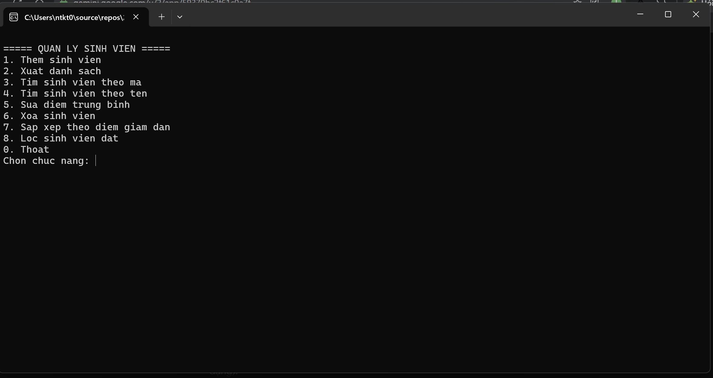

Chương trình gồm các chức năng:

- Thêm sinh viên
- Xuất danh sách
- Tìm sinh viên theo mã
- Tìm sinh viên theo tên
- Sửa điểm trung bình
- Xóa sinh viên
- Sắp xếp theo điểm giảm dần
- Lọc sinh viên đạt
- Thoát chương trình

---

## 3. Thêm sinh viên

Người dùng nhập thông tin sinh viên bao gồm: Mã sinh viên, họ tên, ngày sinh, mã lớp và điểm trung bình. Mã sinh viên không được trùng lặp.

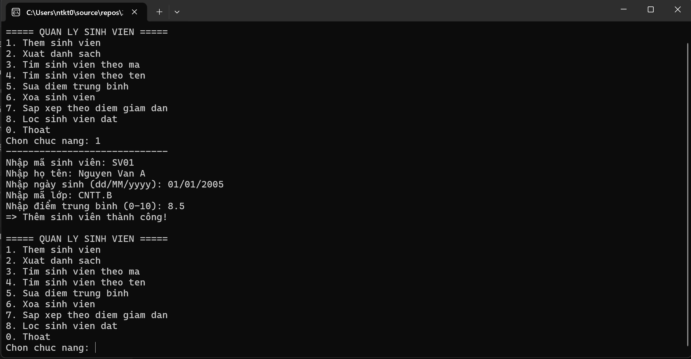

---

## 4. Xuất danh sách

Hiển thị danh sách toàn bộ sinh viên đã nhập kèm theo kết quả xếp loại học lực tương ứng với điểm số.

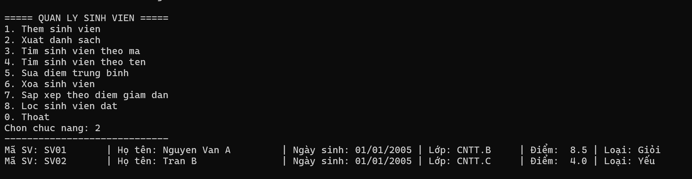

---

## 5. Tìm sinh viên theo mã

Người dùng nhập mã sinh viên để tìm kiếm và hiển thị thông tin chính xác của cá nhân sinh viên đó.

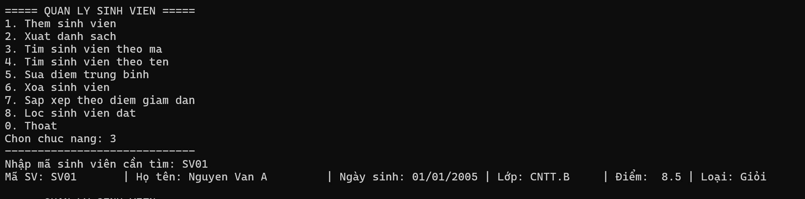

---

## 6. Tìm sinh viên theo tên

Nhập từ khóa họ tên, chương trình sử dụng LINQ để tìm và in ra tất cả sinh viên có tên chứa từ khóa.

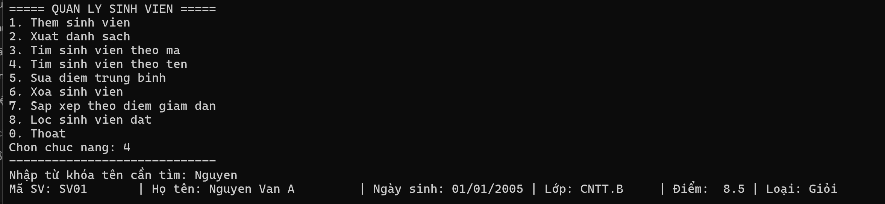

---

## 7. Sửa điểm trung bình

Cập nhật điểm trung bình mới cho sinh viên thông qua mã sinh viên.

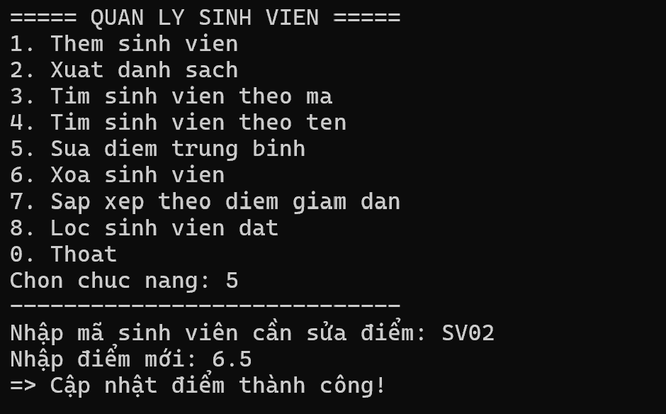

---

## 8. Xóa sinh viên

Xóa sinh viên khỏi danh sách hệ thống dựa vào mã sinh viên cung cấp.

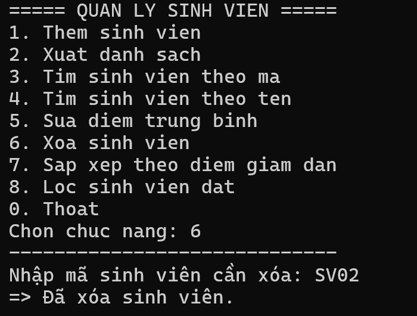

---

## 9. Sắp xếp theo điểm giảm dần

Sử dụng LINQ để sắp xếp danh sách sinh viên theo thứ tự điểm số từ cao xuống thấp.

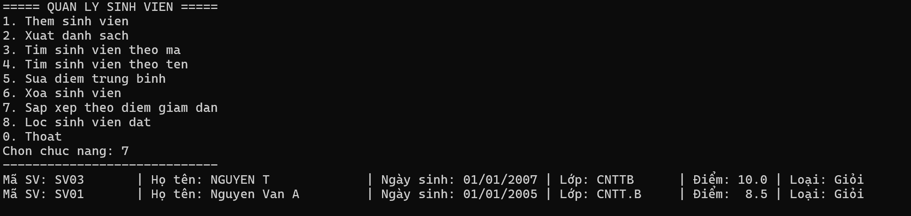

---

## 10. Lọc sinh viên đạt

Lọc và chỉ hiển thị những sinh viên có điểm trung bình từ 5.0 trở lên.

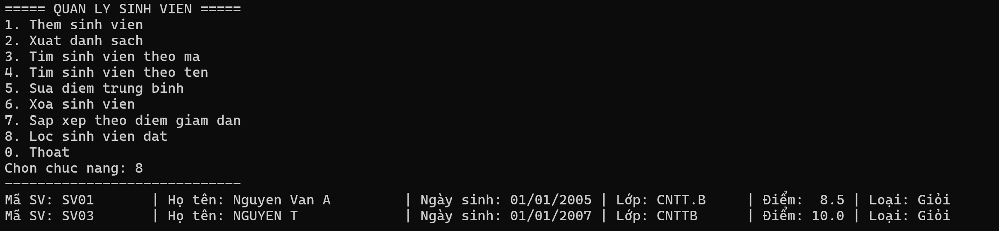

---

## 11. Kiểm tra dữ liệu

Chương trình kiểm tra tính hợp lệ của dữ liệu nhập vào: điểm trung bình phải nằm trong khoảng từ 0 đến 10, bắt lỗi nhập sai định dạng số hoặc ngày tháng.

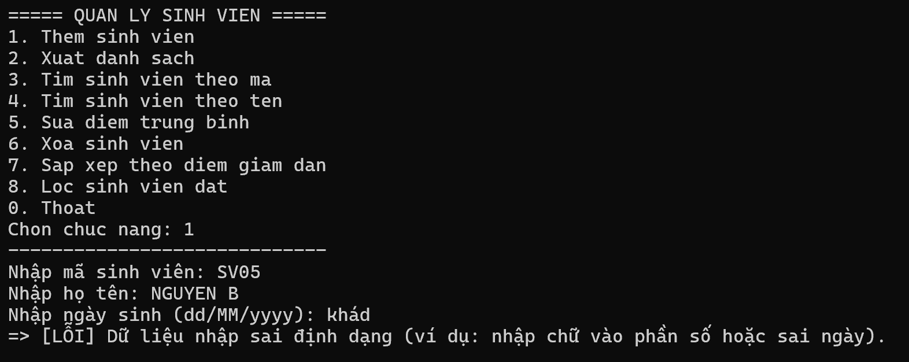

Chương trình cũng xử lý các lỗi nghiệp vụ như thêm trùng mã sinh viên hoặc thao tác với mã không tồn tại.

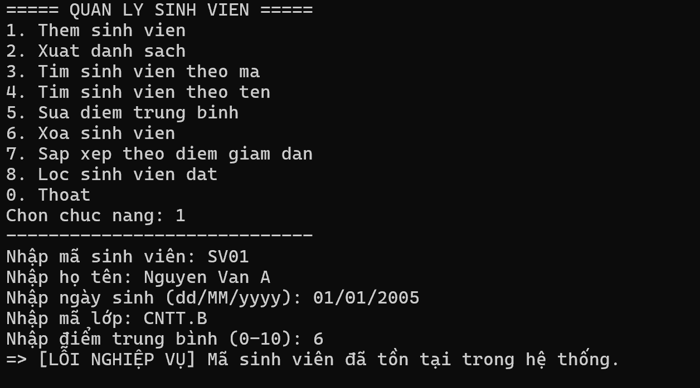

---

## 12. Các thành phần Class chính

Chương trình được chia thành các lớp đối tượng chuyên biệt:

- `Nguoi`: Lớp cha quản lý thông tin cơ bản (Họ tên, Ngày sinh).
- `SinhVien`: Kế thừa từ `Nguoi`, bổ sung thuộc tính (Mã SV, Mã lớp, Điểm TB) và tự động Xếp loại.
- `QuanLySinhVien`: Xử lý nghiệp vụ Thêm, Xóa, Sửa, Tìm kiếm, Lọc bằng `List<SinhVien>` và LINQ.
- `Program`: Xử lý giao diện Console, điều hướng menu và bắt Exception.

---

## 13. Kết luận

Lab03 hoàn thành việc ứng dụng các khái niệm OOP (Class, Object, Property, Constructor, Kế thừa), danh sách List và công cụ LINQ cơ bản trong C#.

Chương trình hoạt động ổn định, phân tách rõ ràng giữa logic nghiệp vụ và giao diện người dùng, đồng thời kiểm soát tốt các ngoại lệ (Exception) phát sinh.