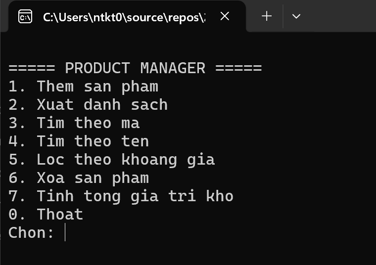
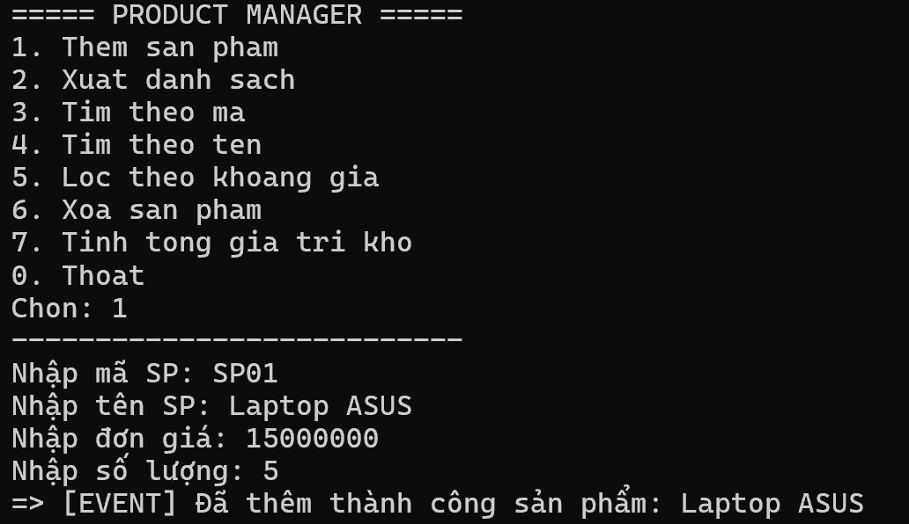
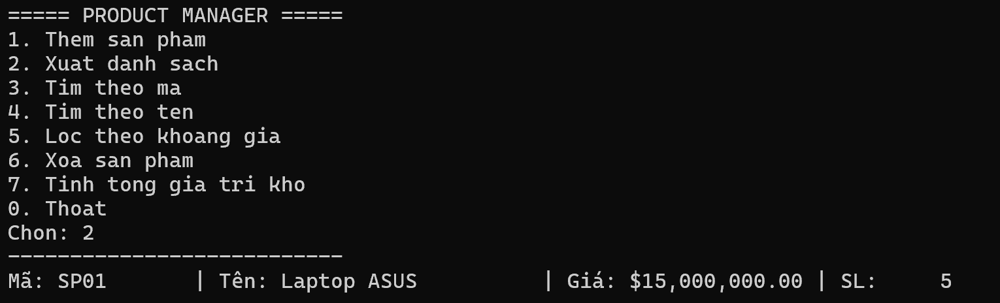
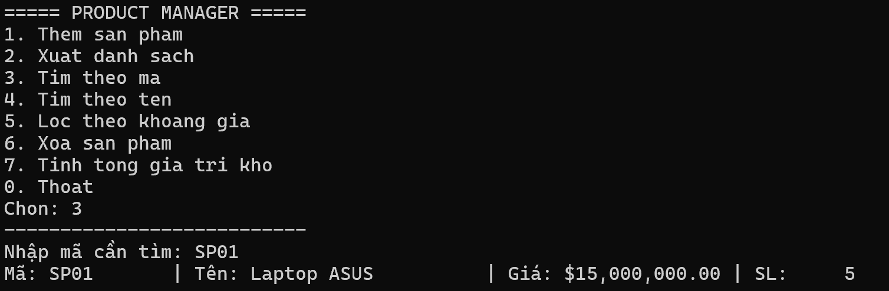
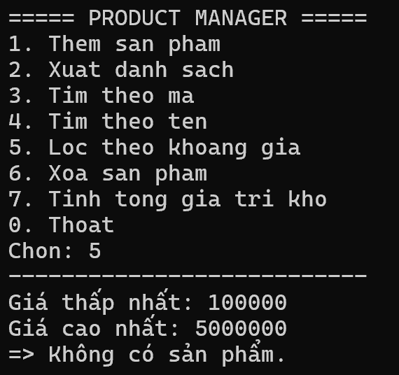
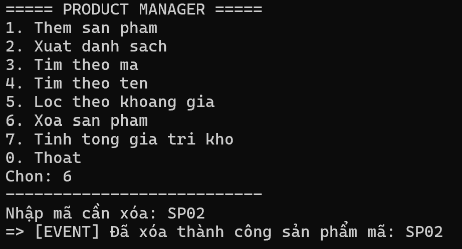
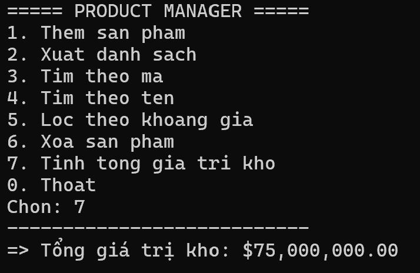
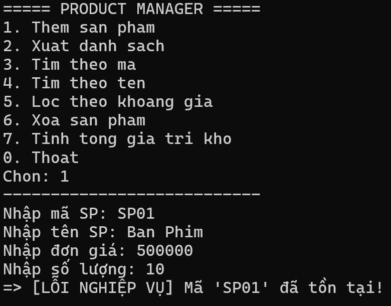

# 2611COMP101904 - Lập trình Windows

**Họ và tên:** KayTy  
**MSSV:** 51.01.104.097  
**Lớp:** 51.CNTT.B  

---

# LAB 04 - EXCEPTION, DELEGATE, EVENT VÀ GENERIC C#

## 1. Giới thiệu
Chương trình Console quản lý sản phẩm bằng C#. Vận dụng kiến thức nâng cao bao gồm Exception tự tạo, Delegate/Event để xử lý sự kiện, Func/Action và cấu trúc Generic class để tái sử dụng mã nguồn.

---

## 2. Menu chương trình

---

## 3. Thêm sản phẩm (Sử dụng Event)
Thêm sản phẩm với điều kiện giá và số lượng không âm. Khi thêm thành công, hệ thống sẽ phát tín hiệu qua `Action<Product> OnProductAdded` để Console tự động in thông báo `[EVENT]`.

---

## 4. Xuất danh sách
In ra danh sách toàn bộ sản phẩm bằng Generic `Repository<T>`.

---

## 5. Tìm kiếm theo mã
Sử dụng phương thức `FindById` trong Repository.

---

## 6. Lọc theo khoảng giá (Sử dụng Func)
Người dùng nhập khoảng giá. Hàm tìm kiếm nhận delegate `Func<Product, bool>` để tự động lọc ra các sản phẩm thỏa điều kiện.

---

## 7. Xóa sản phẩm (Sử dụng Event)
Xóa sản phẩm theo mã. Phát `Action<string> OnProductRemoved` khi xóa thành công.

---

## 8. Tính tổng giá trị kho
Sử dụng LINQ `Sum()` để tính (Số lượng * Đơn giá) của tất cả sản phẩm hiện có.

---

## 9. Xử lý ngoại lệ (Custom Exception)
Chương trình triển khai 2 ngoại lệ tự tạo là `DuplicateProductException` (khi trùng mã) và `ProductNotFoundException` (khi xóa mã không tồn tại), kèm theo `try-catch` để chương trình không bị dừng đột ngột (crash).

