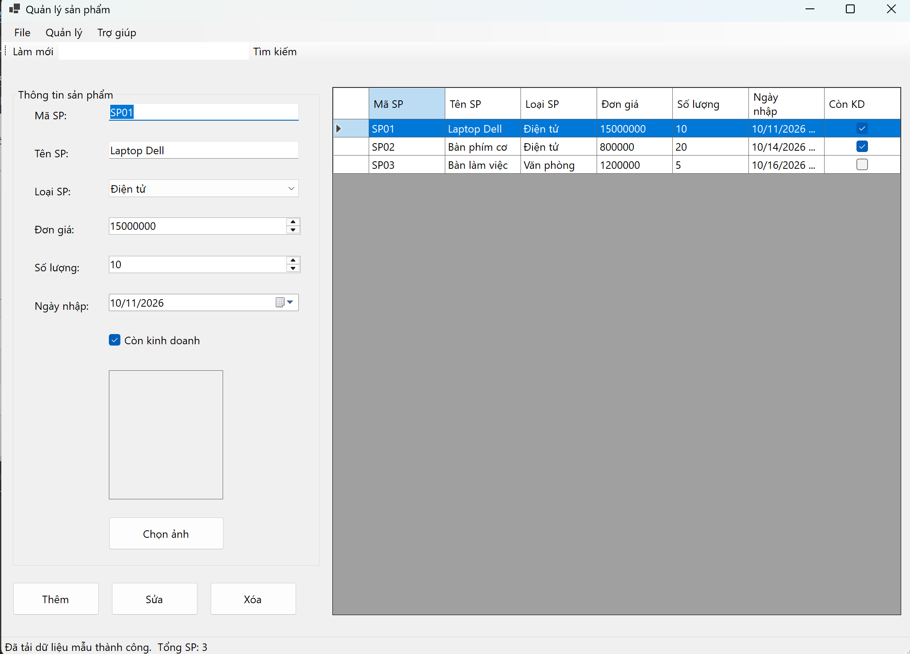
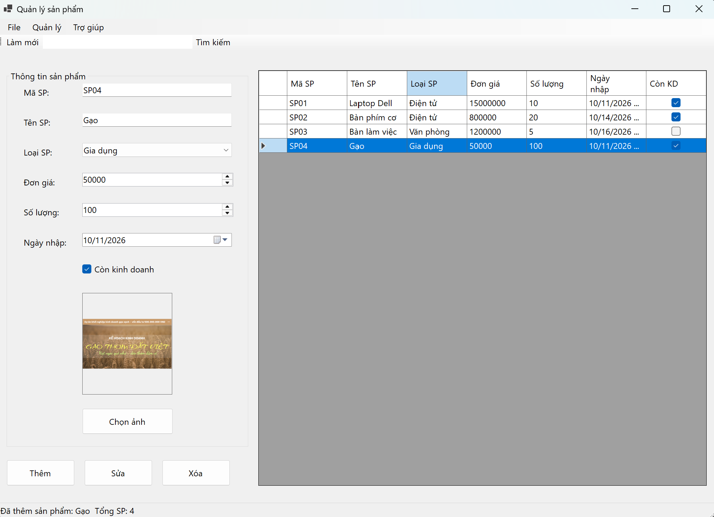
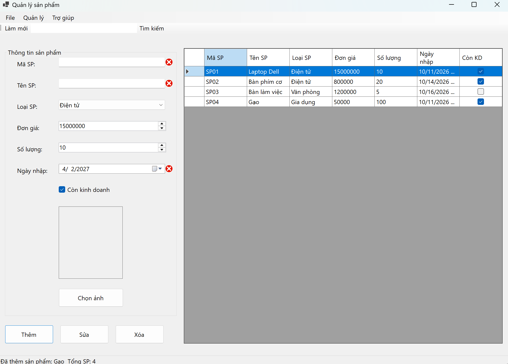
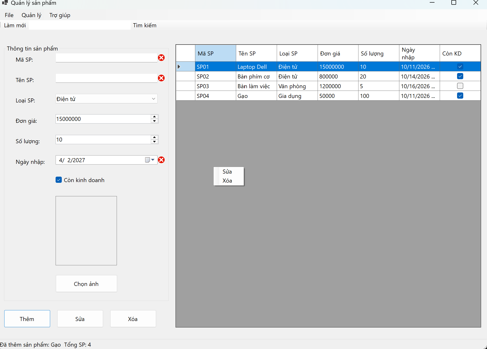
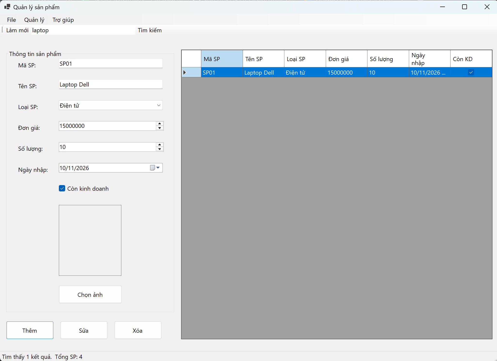

# 2611COMP101904 - Lập trình Windows

**Họ và tên:** KayTy  
**MSSV:** 51.01.104.097  
**Lớp:** 51.CNTT.B  

---

# LAB 06 - WINDOWS FORMS NÂNG CAO VÀ DATAGRIDVIEW

## 1. Giới thiệu
Ứng dụng Windows Forms `ProductManager` quản lý danh sách sản phẩm. Sử dụng `BindingList<T>` kết nối trực tiếp với `DataGridView`. Giao diện tích hợp đầy đủ MenuStrip, ToolStrip, StatusStrip và ContextMenuStrip.

---

## 2. Giao diện chính & Load Dữ liệu mẫu
Khi khởi động, form tự động nạp danh sách loại sản phẩm vào ComboBox và hiển thị 3 sản phẩm mẫu. StatusStrip cập nhật số lượng sản phẩm hiện có.

---

## 3. Thêm sản phẩm & Chọn ảnh (OpenFileDialog)
Cho phép người dùng nhập dữ liệu, sử dụng `OpenFileDialog` để đính kèm hình ảnh hiển thị trên `PictureBox`.

---

## 4. Kiểm tra dữ liệu (ErrorProvider)
Sử dụng `ErrorProvider` để kiểm tra: mã không rỗng và không trùng, đơn giá > 0, ngày nhập không được vượt quá ngày hiện tại.

---

## 5. Sửa, Xóa và Context Menu
Hỗ trợ `ContextMenuStrip` khi nhấp chuột phải lên DataGridView. Đồng bộ hai chiều (2-way binding) giúp việc sửa dữ liệu hiển thị ngay lập tức. Có MessageBox xác nhận trước khi xóa.

---

## 6. Tìm kiếm và Làm mới
Lọc dữ liệu theo tên hoặc mã sản phẩm không phân biệt hoa thường. Nút làm mới giúp xóa trắng các trường nhập liệu và tải lại danh sách ban đầu.

