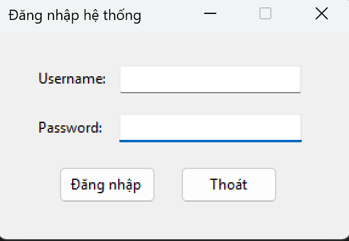
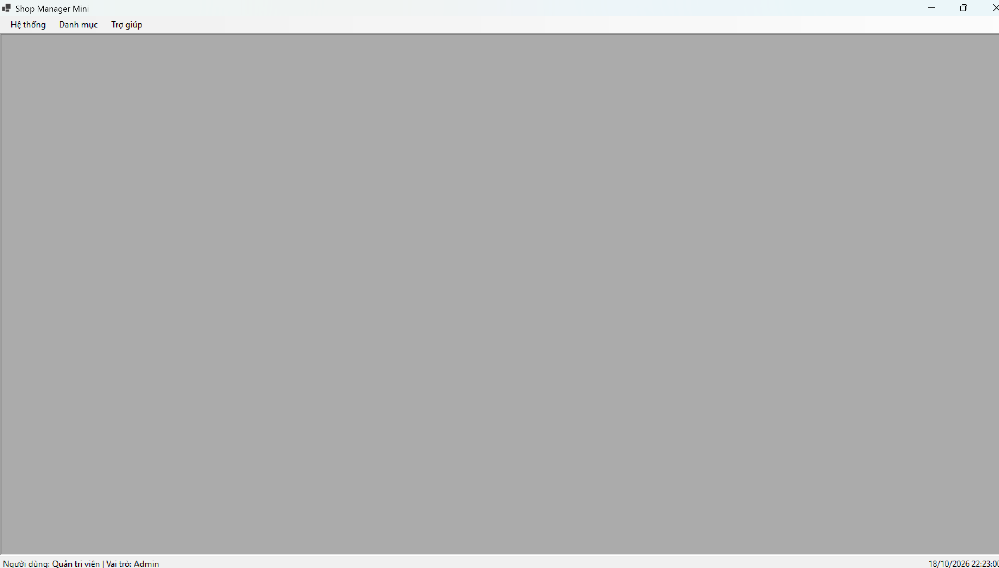
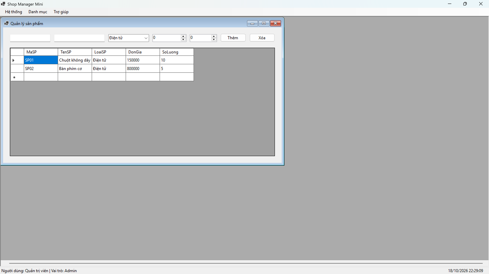
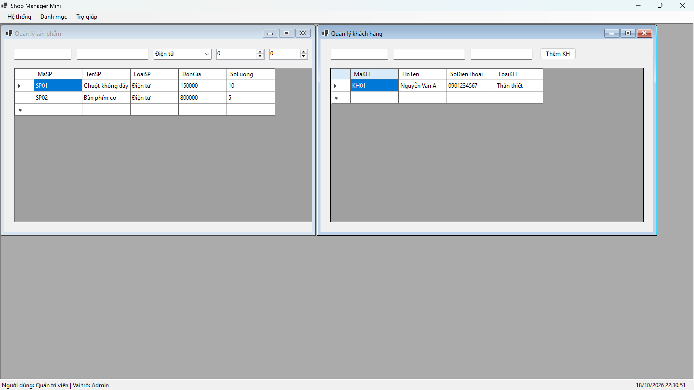
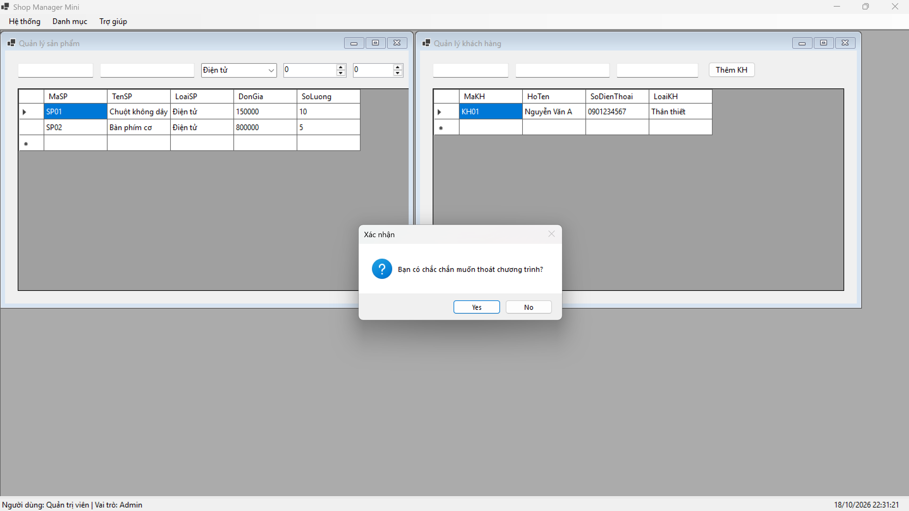

# 2611COMP101904 - Lập trình Windows

**Họ và tên:** Nguyễn Trần Khang Thịnh
**MSSV:** 51.01.104.097  
**Lớp:** K51.CNTT.B  

---

# LAB 07 - SDI, MDI VÀ ỨNG DỤNG NHIỀU FORM TRONG WINFORMS

## 1. Giới thiệu ứng dụng
Ứng dụng `ShopManagerMini` được xây dựng để quản lý cửa hàng mini dựa trên kiến trúc MDI (Multiple Document Interface) trong C# WinForms. Ứng dụng mô phỏng quy trình làm việc thực tế với nhiều màn hình chức năng, xử lý truyền dữ liệu giữa các Form và điều hướng giao diện tập trung.

---

## 2. Mô tả các chức năng chính của sản phẩm

* **Xác thực & Đăng nhập (FrmLogin):**
  * Kiểm tra thông tin tài khoản người dùng (`admin` / `user`).
  * Trả về kết quả xác thực dạng Modal (`ShowDialog()`) trước khi khởi chạy màn hình chính.
* **Màn hình chính MDI (FrmMain):**
  * Đóng vai trò làm Form khung chứa (`IsMdiContainer = true`).
  * Tích hợp thanh MenuStrip điều hướng toàn bộ hệ thống và StatusStrip hiển thị thông tin User, thời gian thực.
  * Cơ chế kiểm soát cửa sổ con: Chống mở trùng lặp các Form con (`FrmProduct`, `FrmCustomer`, `FrmAbout`), tự động kích hoạt Form đang mở.
* **Quản lý sản phẩm (FrmProduct):**
  * Quản lý danh sách sản phẩm lưu trong bộ nhớ bằng `BindingList<T>`.
  * Hiển thị danh sách qua DataGridView; thực hiện Thêm, Xóa, Validation đơn giá/số lượng không âm và kiểm tra trùng mã SP.
* **Quản lý khách hàng (FrmCustomer):**
  * Quản lý thông tin khách hàng (Mã KH, Họ tên, SĐT, Loại KH).
  * Hỗ trợ thêm mới và hiển thị trực quan trên DataGridView.
* **Giới thiệu & Hệ thống (FrmAbout):**
  * Hiển thị thông tin phiên bản phần mềm, thông tin sinh viên thực hiện.
  * Hỗ trợ Đăng xuất quay lại màn hình Login và Xác nhận thoát chương trình.

---

## 3. Trả lời câu hỏi nộp kèm (Lý thuyết)

### Câu 1: SDI và MDI khác nhau như thế nào?
* **SDI (Single Document Interface):** Mỗi Form hoạt động như một cửa sổ độc lập riêng biệt trên hệ điều hành. Các cửa sổ nằm ngang hàng và không phụ thuộc vào nhau.
* **MDI (Multiple Document Interface):** Có một Form cha (`IsMdiContainer = true`) đóng vai trò làm khung chứa. Tất cả các Form con được mở bên trong vùng làm việc của Form cha và không thể kéo ra bên ngoài Form cha.

### Câu 2: Vì sao Form đăng nhập nên dùng ShowDialog()?
* `ShowDialog()` mở Form dưới dạng hộp thoại độc quyền (Modal), chặn mọi thao tác tương tác với các cửa sổ khác cho đến khi Form này đóng lại.
* Cho phép nhận kết quả `DialogResult` (ví dụ `DialogResult.OK`) trả về để file `Program.cs` xác định xem đăng nhập có thành công hay không trước khi quyết định khởi chạy `FrmMain`.

### Câu 3: Trong bài lab này, dữ liệu user được truyền từ FrmLogin sang FrmMain bằng cách nào?
* Dữ liệu được truyền thông qua **Constructor có tham số** của `FrmMain`.
* Cụ thể: `FrmLogin` lưu đối tượng người dùng vào thuộc tính `LoggedInUser`. Trong file `Program.cs`, sau khi kiểm tra `loginForm.ShowDialog() == DialogResult.OK`, chương trình truyền trực tiếp đối tượng này vào Constructor: `new FrmMain(loginForm.LoggedInUser)`.

### Câu 4: Nếu người dùng bấm menu sản phẩm nhiều lần, chương trình xử lý như thế nào để không mở trùng Form?
* Trong hàm `OpenChildForm`, chương trình duyệt qua danh sách các Form con đang mở trong mảng `this.MdiChildren`.
* Sử dụng LINQ để kiểm tra kiểu của Form (`f.GetType() == formType`). Nếu Form đã tồn tại, chương trình gọi phương thức `Activate()` để đưa Form đó lên trên cùng thay vì khởi tạo đối tượng `new` mới.

### Câu 5: Khi nào nên dùng constructor, khi nào nên dùng property để truyền dữ liệu giữa các Form?
* **Dùng Constructor:** Khi dữ liệu là **bắt buộc phải có** ngay từ thời điểm khởi tạo Form để Form có thể thiết lập trạng thái ban đầu và hoạt động chính xác (ví dụ: thông tin User đăng nhập).
* **Dùng Property:** Khi dữ liệu là **tùy chọn**, không bắt buộc có lúc khởi tạo, hoặc khi cần cập nhật/thay đổi dữ liệu liên tục sau khi Form đã được hiển thị lên màn hình.

---

## 4. Hình ảnh minh họa chức năng

### 4.1. Màn hình đăng nhập (FrmLogin)

### 4.2. Màn hình chính MDI (FrmMain) sau khi đăng nhập

### 4.3. Quản lý sản phẩm (FrmProduct)

### 4.4. Quản lý khách hàng (FrmCustomer)

### 4.5. Xác nhận khi thoát chương trình
