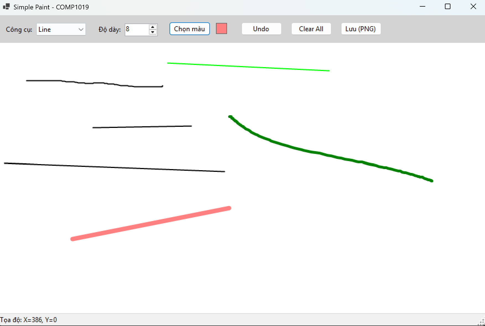
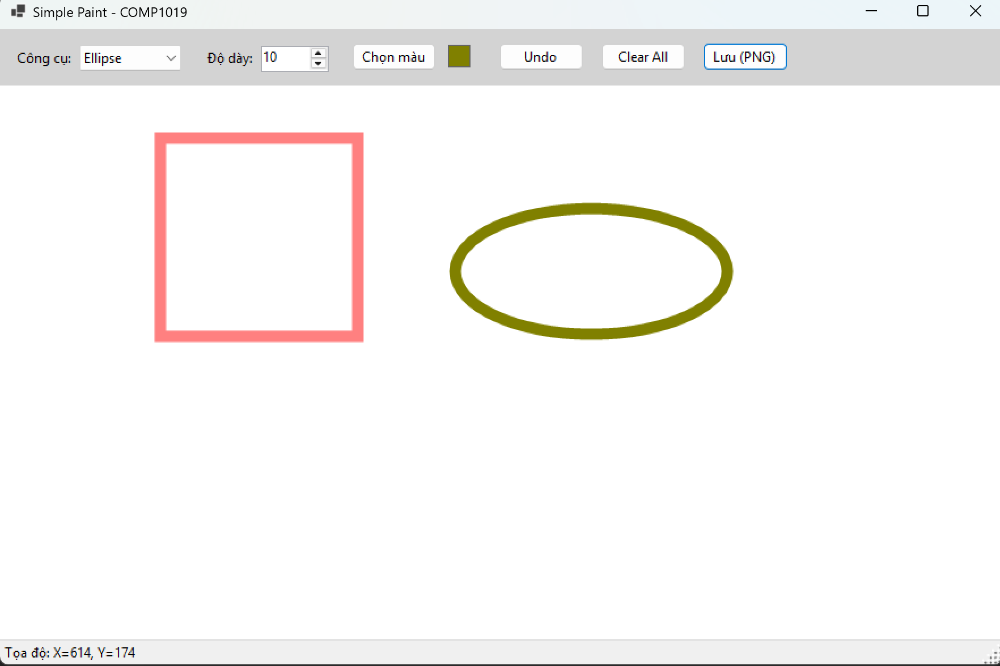
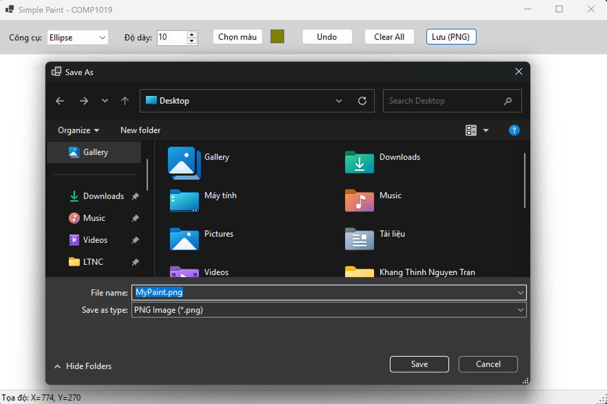

# 2611COMP101904 - Lập trình Windows

**Họ và tên:** Nguyễn Trần Khang Thịnh  
**MSSV:** 51.01.104.097  
**Lớp:** K51.CNTT.B  

---

# LAB 08 - XÂY DỰNG ỨNG DỤNG PAINT ĐƠN GIẢN (WINFORMS & GDI+)

## 1. Giới thiệu chức năng
Ứng dụng Simple Paint mô phỏng chức năng vẽ cơ bản tương tự Microsoft Paint, ứng dụng các kiến thức GDI+ (Graphics, Pen, Brush) và quản lý đối tượng vẽ (OOP) trong môi trường Windows Forms.

* **Tính năng cơ bản:**
  * Vẽ tự do (Pen), Đường thẳng (Line), Hình chữ nhật (Rectangle), và Hình Elip (Ellipse).
  * Tùy chỉnh màu sắc (ColorDialog) và độ dày nét vẽ (NumericUpDown từ 1-20).
  * Hiển thị tọa độ chuột theo thời gian thực (MouseMove).
  * Lưu trữ cấu trúc đối tượng `List<DrawItem>` kết hợp `Paint Event`, giúp bảo toàn nét vẽ khi thu phóng (resize) cửa sổ.
  * Hỗ trợ xóa nét gần nhất (Undo) và xóa toàn bộ (Clear).
* **Tính năng nâng cao (Đã hoàn thiện):**
  * Lưu tác phẩm thành tệp định dạng `.png` (Sử dụng DrawToBitmap).
  * Hỗ trợ phím tắt `Ctrl + Z` để Undo thao tác nhanh chóng.

---

## 2. Hình ảnh chạy thử nghiệm

### 2.1. Vẽ tự do (Pen) và Đường thẳng (Line) đa sắc màu

### 2.2. Vẽ Hình chữ nhật (Rectangle) và Hình Elip (Ellipse) với nét dày

### 2.3. Bảng chọn màu và Xuất file PNG
