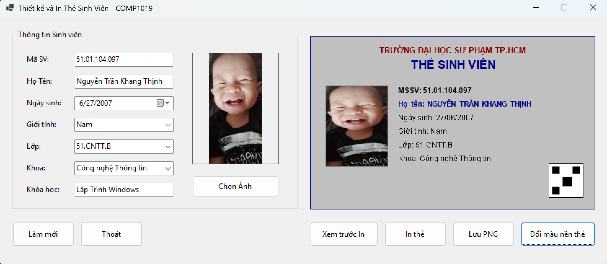
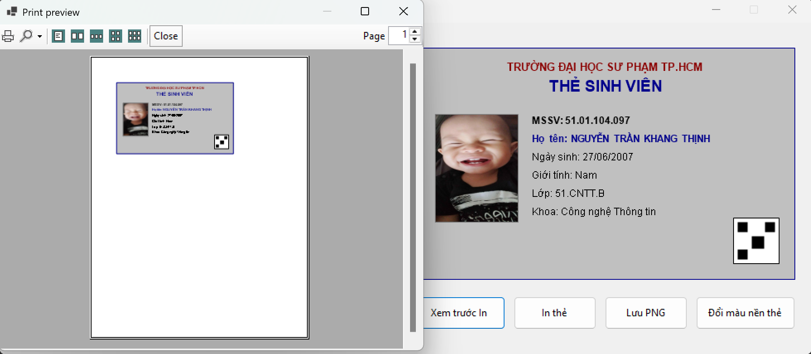

# 2611COMP101904 - Lập trình Windows

**Họ và tên:** Nguyễn Trần Khang Thịnh  
**MSSV:** 51.01.104.097  
**Lớp:** 51.CNTT.B  

---

# LAB 09 - THIẾT KẾ VÀ IN THẺ SINH VIÊN BẰNG WINFORMS

## 1. Giới thiệu chức năng
Ứng dụng hỗ trợ thiết kế, xem trước và in thẻ sinh viên trực tiếp. Hệ thống sử dụng `Graphics` (GDI+) để tự động vẽ thẻ sinh viên trên `Panel` (Live Preview) và tích hợp `PrintDocument` để kết xuất dữ liệu ra máy in chính xác 100% so với bản xem trước trên màn hình.

### Các chức năng nổi bật (Bao gồm phần mở rộng):
* **Live Preview:** Dữ liệu nhập vào `TextBox`, `ComboBox` lập tức được render lên thẻ xem trước mà không cần tải lại.
* **Xử lý ảnh đại diện:** Chọn ảnh tỷ lệ chuẩn (Zoom), không khóa tệp tin nguồn (sử dụng bản sao Bitmap).
* **Đồ họa GDI+:** Vẽ khung, văn bản (khử răng cưa), hình ảnh và đặc biệt tích hợp **tạo mã QR giả lập** góc dưới thẻ.
* **Tùy biến:** Tích hợp `ColorDialog` cho phép người dùng đổi màu nền thẻ linh hoạt.
* **In ấn & Xuất file:** Xem trước bản in (`PrintPreviewDialog`), In qua máy in (`PrintDialog`) và Lưu trực tiếp thẻ thành tệp `.png`.

---

## 2. Kịch bản kiểm thử (8 Test Cases)

| STT | Tên Test Case | Mô tả thao tác | Kết quả mong đợi |
|-----|---------------|----------------|------------------|
| **1** | Bỏ trống Mã SV | Để trống ô Mã SV, bấm "Xem trước in" hoặc "Lưu PNG". | Hiển thị MessageBox cảnh báo "Mã sinh viên không được để trống" và chặn thực thi lệnh. |
| **2** | Bỏ trống Họ Tên | Nhập Mã SV, để trống Họ tên, bấm "In thẻ". | Hiển thị MessageBox cảnh báo "Họ tên sinh viên không được để trống" và chặn thực thi lệnh. |
| **3** | Không chọn Ảnh đại diện | Nhập đủ thông tin Text nhưng không chọn ảnh, bấm "Lưu PNG". | Hiển thị cảnh báo yêu cầu "Vui lòng chọn ảnh đại diện!". |
| **4** | Cập nhật Live Preview | Đang có sẵn thông tin, gõ thêm chữ vào ô Họ Tên hoặc chọn Lớp khác. | Chữ trên Panel xem trước tự động thay đổi theo thời gian thực tương ứng với phím gõ. |
| **5** | Đổi màu nền thẻ | Bấm nút "Đổi màu nền thẻ", chọn một màu bất kỳ (VD: màu Vàng). | Nền của thẻ xem trước đổi sang màu vừa chọn ngay lập tức. |
| **6** | Xem trước bản in (Print Preview) | Nhập đầy đủ thông tin hợp lệ, bấm "Xem trước In". | Cửa sổ Print Preview hiện ra, hiển thị trang in A4 chứa thẻ sinh viên với bố cục khớp 100% Panel xem trước. |
| **7** | Lưu file ảnh PNG | Bấm nút "Lưu PNG", chọn đường dẫn lưu ra Desktop. | Ứng dụng thông báo "Lưu thẻ thành công!". Mở Desktop xuất hiện ảnh thẻ định dạng `.png` rõ nét. |
| **8** | Làm mới Form (Reset) | Bấm nút "Làm mới". | Toàn bộ TextBox bị xóa trắng, Combobox/DateTimePicker về mặc định, mất ảnh, Panel quay về màu nền mặc định (LightCyan). |

---

## 3. Hình ảnh minh họa

### 3.1. Giao diện chính (Thông tin, Live Preview và Đổi màu nền)

### 3.2. Cửa sổ xem trước bản in (Print Preview)
