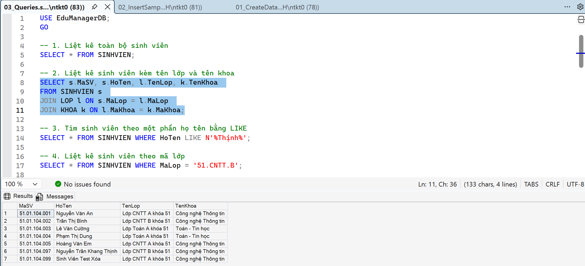
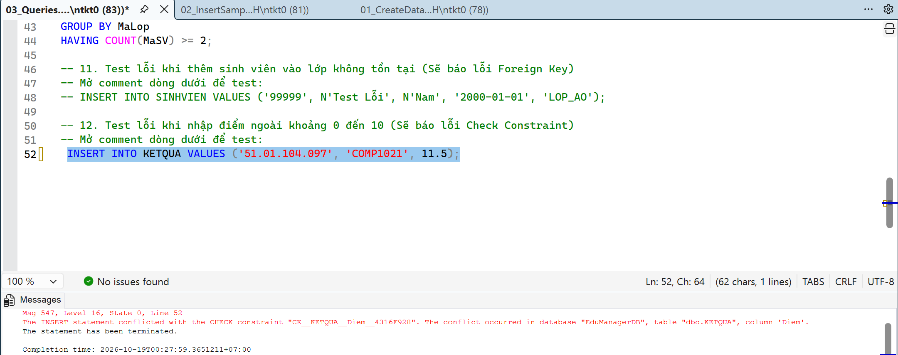

# 2611COMP101904 - Lập trình Windows

**Họ và tên:** Nguyễn Trần Khang Thịnh  
**MSSV:** 51.01.104.097  
**Lớp:** 51.CNTT.B  

---

# LAB 10 - THIẾT KẾ VÀ CÀI ĐẶT CƠ SỞ DỮ LIỆU EDUMANAGERDB

## 1. Mục tiêu hoàn thành
* Thiết kế và khởi tạo thành công CSDL quan hệ `EduManagerDB` trên SQL Server.
* Cài đặt đầy đủ 6 bảng dữ liệu (KHOA, LOP, SINHVIEN, MONHOC, KETQUA, TAIKHOAN) với các khóa chính, khóa ngoại tham chiếu chính xác.
* Áp dụng toàn bộ Ràng buộc (Constraints):
  * `CHECK (GioiTinh IN (N'Nam', N'Nữ'))` cho giới tính.
  * `CHECK (SoTinChi > 0)` cho tín chỉ môn học.
  * `CHECK (Diem >= 0 AND Diem <= 10)` cho điểm kết quả.
* Chèn thành công dữ liệu mẫu đảm bảo tính toàn vẹn tham chiếu.
* Thực thi 12 câu truy vấn (SELECT, JOIN, GROUP BY, UPDATE, DELETE) và kiểm thử ràng buộc ném ngoại lệ (Exception) đúng như thiết kế.

## 2. Hình ảnh thực thi truy vấn

### 2.1. Kết quả Join dữ liệu và Tính điểm trung bình (Query 2 & 8)

### 2.2. Kiểm thử ràng buộc (Bắt lỗi khi nhập điểm > 10)
