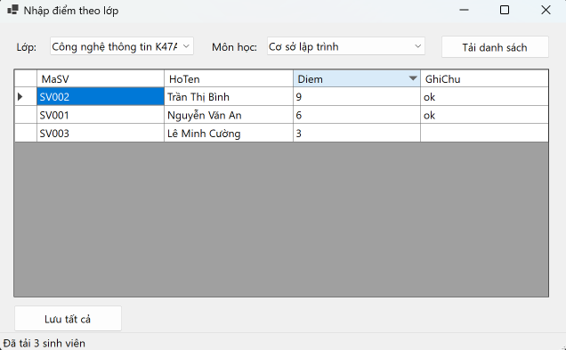
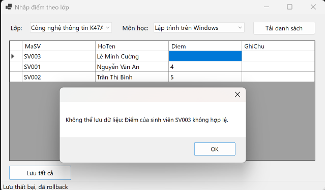
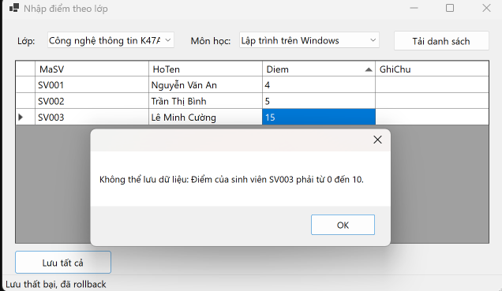
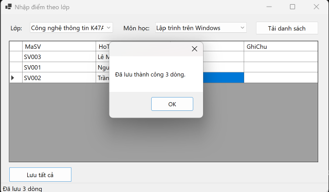

<div align="center">

# 🎓 Hệ Thống Quản Lý Kết Quả Học Tập (QLSinhVienLab12)


**Bài thực hành Lab 12 - Học phần COMP1019 (Lập trình trên Windows)**  
**Trường Đại học Sư phạm Thành phố Hồ Chí Minh (HCMUE)**

</div>

---

## 📑 Mục lục
1. [Giới thiệu dự án](#-giới-thiệu-dự-án)
2. [Các tính năng cốt lõi](#-các-tính-năng-cốt-lõi)
3. [Kiến trúc hệ thống](#-kiến-trúc-hệ-thống)
4. [Thiết kế Cơ sở dữ liệu](#-thiết-kế-cơ-sở-dữ-liệu)
5. [Thư viện hình ảnh (Screenshots)](#-thư-viện-hình-ảnh-screenshots)
6. [Hướng dẫn cài đặt & Khởi chạy](#-hướng-dẫn-cài-đặt--khởi-chạy)
7. [Thông tin tác giả](#-thông-tin-tác-giả)

---

## 📖 Giới thiệu dự án

**QLSinhVienLab12** là một ứng dụng Desktop (Windows Forms) được phát triển bằng ngôn ngữ C# nhằm mô phỏng nghiệp vụ quản lý và nhập điểm cho sinh viên theo từng lớp và môn học. 

Dự án này tập trung vào việc giải quyết bài toán toàn vẹn dữ liệu trong môi trường hệ thống thực tế thông qua việc áp dụng nghiêm ngặt các kỹ thuật lập trình cơ sở dữ liệu nâng cao: **Database Transactions** (Giao dịch), **Stored Procedures** (Thủ tục lưu trữ), và **Data Binding** (Liên kết dữ liệu động).

---

## 🚀 Các tính năng cốt lõi

### 1. Trải nghiệm người dùng (UX) & Giao diện (UI)
*   **Dynamic Data Binding:** Các danh sách danh mục (Lớp học, Môn học) được nạp tự động vào hệ thống `ComboBox` ngay khi Form khởi tạo.
*   **Hiển thị dữ liệu trực quan:** Danh sách sinh viên và kết quả học tập được ánh xạ trực tiếp lên `DataGridView` thông qua `BindingSource` và `DataTable`, giúp thao tác nhập liệu trực quan như trên Excel.
*   **Thanh trạng thái (StatusStrip):** Cập nhật liên tục trạng thái thao tác của người dùng.

### 2. Xử lý nghiệp vụ & Bảo mật dữ liệu
*   **Kiểm soát giao dịch (SqlTransaction):** Tính năng "Lưu tất cả" xử lý việc cập nhật điểm của cả lớp trong một Transaction duy nhất. 
    *   ✔️ **Commit:** Nếu toàn bộ dữ liệu hợp lệ, hệ thống ghi nhận đồng loạt.
    *   ❌ **Rollback:** Nếu phát hiện bất kỳ một lỗi nhỏ, hệ thống lập tức hoàn tác toàn bộ để đảm bảo CSDL không bị rác.
*   **Validation đa tầng:** 
    *   Ngăn chặn nhập dữ liệu rỗng (Null).
    *   Ngăn chặn nhập sai kiểu dữ liệu (chữ cái vào ô điểm số).
    *   Ràng buộc logic nghiệp vụ (Điểm số bắt buộc phải nằm trong khoảng 0 đến 10).
*   **Chống SQL Injection:** Sử dụng 100% `SqlParameter` khi truyền dữ liệu xuống CSDL.

---

## 🏗 Kiến trúc hệ thống

Dự án được cấu trúc theo nguyên tắc phân tách trách nhiệm (Separation of Concerns):

```text
QLSinhVienLab12/
├── 📁 DAL/                   # Tầng truy xuất dữ liệu (Data Access Layer)
│   ├── 📄 Database.cs         # Đóng gói chuỗi kết nối và quản lý SqlConnection
│   └── 📄 KetQuaDAL.cs        # Chứa logic gọi Stored Procedure và SqlTransaction
├── 📁 Database/              # Tầng lưu trữ (Database Layer)
│   └── 📄 QLSinhVienLab12.sql # Script định nghĩa Schema & Dữ liệu mẫu
├── 📁 Forms/                 # Tầng giao diện (Presentation Layer)
│   ├── 📄 FrmNhapDiemTheoLop.cs # Xử lý UI, Validation và Data Binding
│   └── 📄 FrmNhapDiemTheoLop.Designer.cs
└── 📄 Program.cs             # Entry point của ứng dụng

```

---

## 🗄️ Thiết kế Cơ sở dữ liệu

### 1. Sơ đồ thực thể

* **`LOP(MaLop, TenLop)`**: `MaLop` (Primary Key).
* **`SINHVIEN(MaSV, HoTen, NgaySinh, MaLop)`**: `MaSV` (Primary Key). Ràng buộc `MaLop` tham chiếu `LOP(MaLop)`.
* **`MONHOC(MaMon, TenMon, SoTinChi)`**: `MaMon` (Primary Key).
* **`KETQUA(MaSV, MaMon, Diem, GhiChu)`**: Khóa chính kép `(MaSV, MaMon)`. Tham chiếu `SINHVIEN` và `MONHOC`. Ràng buộc Check `Diem >= 0 AND Diem <= 10`.

### 2. Danh mục Stored Procedures

* `sp_Lop_GetAll`: Truy xuất toàn bộ danh mục lớp.
* `sp_MonHoc_GetAll`: Truy xuất toàn bộ danh mục môn học.
* `sp_KetQua_GetByLopMon (@MaLop, @MaMon)`: Truy xuất danh sách sinh viên thuộc lớp chỉ định, kèm theo điểm số hiện tại bằng `LEFT JOIN`.
* `sp_KetQua_Save (@MaSV, @MaMon, @Diem, @GhiChu)`: Ứng dụng kỹ thuật `UPSERT` để thêm mới hoặc cập nhật điểm.

---

## 📸 Thư viện hình ảnh (Screenshots)

<div align="center">

**1. Giao diện trước khi lưu (Tải danh sách & Nhập liệu)**
<br/>

<br/><i>Minh họa: Dữ liệu được nạp thành công và sẵn sàng để nhập điểm mới.</i><br/><br/>

**2. Hệ thống Validation (Bắt lỗi nhập liệu)**
<br/>

<br/><i>Minh họa: Ngăn chặn thao tác khi người dùng nhập điểm sai quy định (ngoài khoảng 0-10, sai định dạng).</i><br/><br/>

**3. Khôi phục giao dịch (Transaction Rollback)**
<br/>

<br/><i>Minh họa: Hệ thống hủy bỏ toàn bộ thao tác lưu và báo lỗi để bảo vệ tính toàn vẹn CSDL.</i><br/><br/>

**4. Lưu điểm thành công (Transaction Commit)**
<br/>

<br/><i>Minh họa: Ghi nhận thành công đồng loạt điểm số của sinh viên thông qua SqlTransaction.</i><br/>

</div>


## ⚙️ Hướng dẫn cài đặt & Khởi chạy

1. Mở file `QLSinhVienLab12.sql` trong SQL Server Management Studio (SSMS) và nhấn `F5` để khởi tạo Database.
2. Clone project: `git clone https://github.com/ntkt2706/2611COMP101904-Lap-trinh-Windows.git
3. Mở file `DAL/Database.cs` và điều chỉnh `ConnectionString` khớp với cấu hình SQL Server local của bạn.
4. Nhấn `F5` trong Visual Studio để biên dịch và chạy ứng dụng.

---

## 👤 Thông tin tác giả

* **Họ và tên:** Nguyễn Trần Khang Thịnh
* **Mã số sinh viên:** `51.01.104.097`
* **Lớp:** `51.CNTT.B`
* **Đơn vị:** Khoa Công nghệ Thông tin - Đại học Sư phạm TP.HCM
* **Hồ sơ GitHub:** [ntkt2706](https://www.google.com/search?q=https://github.com/ntkt2706)
