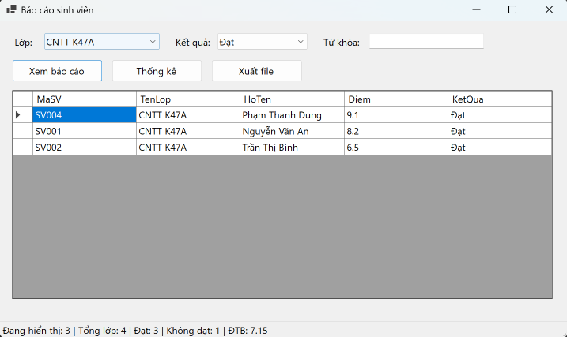
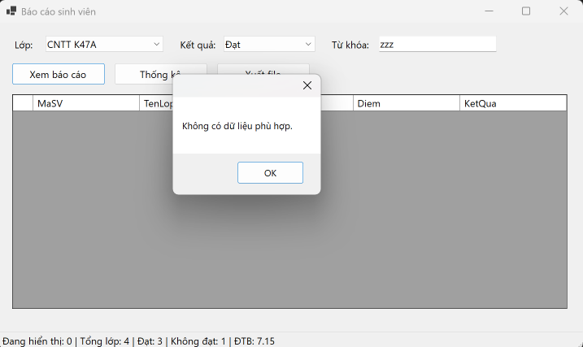
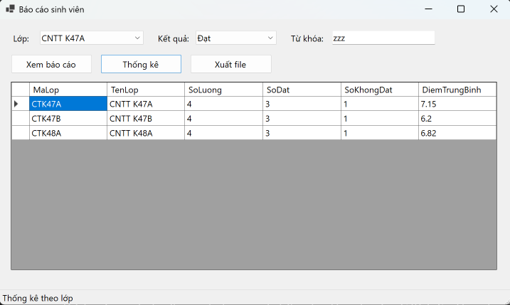
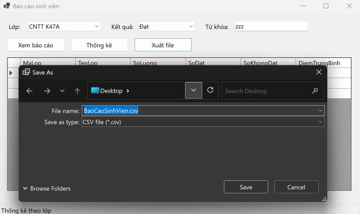
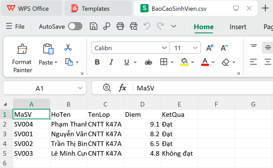

<div align="center">

# 📊 Báo Cáo Sinh Viên Bằng LINQ (StudentReportDemo)


**Bài thực hành Lab 13 - Học phần COMP1019 (Lập trình trên Windows)**  
**Trường Đại học Sư phạm Thành phố Hồ Chí Minh (HCMUE)**

</div>

---

## 📑 Mục lục
1. [Giới thiệu dự án](#-giới-thiệu-dự-án)
2. [Các tính năng cốt lõi](#-các-tính-năng-cốt-lõi)
3. [Kiến trúc hệ thống](#-kiến-trúc-hệ-thống)
4. [Mô hình dữ liệu & LINQ](#-mô-hình-dữ-liệu--linq)
5. [Thư viện hình ảnh (Screenshots)](#-thư-viện-hình-ảnh-screenshots)
6. [File báo cáo đã xuất](#-file-báo-cáo-đã-xuất)
7. [Hướng dẫn cài đặt & Khởi chạy](#-hướng-dẫn-cài-đặt--khởi-chạy)
8. [Thông tin tác giả](#-thông-tin-tác-giả)

---

## 📖 Giới thiệu dự án

**StudentReportDemo** là ứng dụng Desktop (Windows Forms) viết bằng C#, mô phỏng module **báo cáo danh sách sinh viên theo lớp**. Người dùng chọn lớp, chọn điều kiện kết quả học tập, nhập từ khóa tìm kiếm rồi xem báo cáo. Kết quả có thể được thống kê theo lớp và xuất ra file **CSV** hoặc **TXT**.

Dự án tập trung vào việc xử lý dữ liệu trong bộ nhớ bằng **LINQ** (lọc, sắp xếp, chọn cột, nhóm, thống kê) và hiển thị kết quả lên `DataGridView`. Dữ liệu là danh sách mẫu gồm **12 sinh viên thuộc 3 lớp**, nên chương trình không cần cài đặt database.

---

## 🚀 Các tính năng cốt lõi

### 1. Trải nghiệm người dùng (UX) & Giao diện (UI)
*   **Nạp danh mục tự động:** Danh sách lớp (lấy từ dữ liệu bằng `Select` + `Distinct`) và các lựa chọn kết quả (*Tất cả / Đạt / Không đạt*) được nạp vào `ComboBox` ngay khi Form mở.
*   **Báo cáo trực quan:** Kết quả lọc hiển thị trên `DataGridView`, sắp xếp **giảm dần theo điểm** (bằng điểm thì xếp theo họ tên).
*   **Thanh trạng thái (StatusStrip):** Hiển thị số dòng đang xem, tổng sinh viên của lớp, số đạt, số không đạt và điểm trung bình (ĐTB).

### 2. Xử lý nghiệp vụ & Tính đúng đắn của dữ liệu
*   **Lọc đa điều kiện:** Kết hợp lớp, kết quả học tập và từ khóa (tìm theo mã hoặc họ tên, không phân biệt hoa thường).
*   **Thống kê theo lớp:** Bấm **Thống kê** để xem số lượng, số đạt, số không đạt và điểm trung bình của từng lớp.
*   **Xuất file CSV/TXT:** Dùng `SaveFileDialog` để chọn nơi lưu, ghi mã hóa **UTF-8 (có BOM)** nên Excel mở hiển thị đúng tiếng Việt.
*   **Xử lý ngoại lệ & thông báo rõ ràng:**
    *   Thông báo khi không có dữ liệu phù hợp để hiển thị hoặc để xuất.
    *   `try-catch` khi ghi file (file đang được mở, không có quyền ghi...).
    *   Chặn lỗi `null` khi ComboBox chưa có giá trị, tránh lỗi khi tính trung bình trên danh sách rỗng.
*   **Thuộc tính tính toán:** `KetQua` chỉ đọc, tự suy ra từ `Diem` nên không bao giờ lệch dữ liệu.

---

## 🏗 Kiến trúc hệ thống

Dự án được chia theo nguyên tắc phân tách trách nhiệm, mỗi hàm làm một việc (`TaoDuLieuMau`, `LoadComboBox`, `XemBaoCao`, `CapNhatThongKe`, `XuatFile`):

```text
StudentReportDemo/
├── 📁 Models/                # Tầng dữ liệu (Model)
│   └── 📄 SinhVien.cs         # Lớp SinhVien, KetQua là thuộc tính chỉ đọc
├── 📁 Forms/                 # Tầng giao diện (Presentation Layer)
│   ├── 📄 FrmBaoCaoSinhVien.cs          # Xử lý LINQ, thống kê, xuất file
│   └── 📄 FrmBaoCaoSinhVien.Designer.cs
├── 📁 Output/
│   └── 📄 BaoCaoSinhVien.csv  # File báo cáo mẫu đã xuất
├── 📁 Images/                # Ảnh chụp màn hình dùng trong README
└── 📄 Program.cs             # Entry point của ứng dụng
```

---

## 🧮 Mô hình dữ liệu & LINQ

### 1. Lớp `SinhVien`

| Thuộc tính | Kiểu | Mô tả |
|---|---|---|
| `MaSV` | `string` | Mã sinh viên |
| `HoTen` | `string` | Họ tên sinh viên |
| `MaLop` | `string` | Mã lớp |
| `TenLop` | `string` | Tên lớp |
| `Diem` | `double` | Điểm trung bình |
| `KetQua` | `string` (chỉ đọc) | `"Đạt"` nếu `Diem >= 5`, ngược lại `"Không đạt"` |

### 2. Các thao tác LINQ đã sử dụng

| Chức năng | Phương thức LINQ | Vị trí |
|---|---|---|
| Lấy danh sách lớp không trùng | `Select`, `Distinct`, `OrderBy` | `LoadComboBox` |
| Lọc theo lớp, kết quả, từ khóa | `Where` | `XemBaoCao` |
| Sắp xếp giảm dần theo điểm | `OrderByDescending`, `ThenBy` | `XemBaoCao` |
| Chọn các cột hiển thị | `Select` | `XemBaoCao` |
| Đếm đạt / không đạt, tính ĐTB | `Count`, `Average` | `CapNhatThongKe` |
| Gom nhóm và thống kê theo lớp | `GroupBy`, `Select`, `Count`, `Average` | `btnThongKe_Click` |

Ví dụ truy vấn chính:

```csharp
var baoCao = danhSachSinhVien
    .Where(sv => sv.MaLop == maLop)
    .OrderByDescending(sv => sv.Diem)
    .ThenBy(sv => sv.HoTen)
    .Select(sv => new { sv.MaSV, sv.HoTen, sv.TenLop, sv.Diem, sv.KetQua })
    .ToList();
```

---

## 📸 Thư viện hình ảnh (Screenshots)

<div align="center">

**1. Báo cáo sau khi lọc dữ liệu**
<br/>

<br/><i>Minh họa: Lọc theo lớp CNTT K47A, kết quả "Đạt", sắp xếp giảm dần theo điểm; thanh trạng thái hiển thị tổng số, số đạt, số không đạt và ĐTB.</i><br/><br/>

**2. Thông báo khi không có dữ liệu phù hợp**
<br/>

<br/><i>Minh họa: Từ khóa không khớp sinh viên nào, chương trình thông báo rõ ràng cho người dùng.</i><br/><br/>

**3. Thống kê theo lớp**
<br/>

<br/><i>Minh họa: Dùng LINQ `GroupBy` để thống kê số lượng, số đạt, số không đạt và điểm trung bình từng lớp.</i><br/><br/>

**4. Xuất file báo cáo thành công**
<br/>

<br/><i>Minh họa: Chọn nơi lưu bằng SaveFileDialog và nhận thông báo xuất file thành công.</i><br/><br/>

**5. File CSV mở bằng Excel**
<br/>

<br/><i>Minh họa: Nội dung file đã xuất hiển thị đúng tiếng Việt nhờ mã hóa UTF-8 có BOM.</i><br/>

</div>

---

## 📄 File báo cáo đã xuất

File báo cáo mẫu được xuất từ chương trình: [`Output/BaoCaoSinhVien.csv`](Output/BaoCaoSinhVien.csv)

---

## ⚙️ Hướng dẫn cài đặt & Khởi chạy

Lab này **không cần cài SQL Server**, dữ liệu mẫu được tạo sẵn trong code (hàm `TaoDuLieuMau`).

1. Clone repo: `git clone https://github.com/ntkt2706/2611COMP101904-Lap-trinh-Windows.git`
2. Mở thư mục `Lab13`, mở file `.sln` bằng Visual Studio (cần .NET 8 trở lên).
3. Nhấn `F5` để biên dịch và chạy ứng dụng.
4. Chọn lớp, kết quả, nhập từ khóa (nếu cần) rồi bấm **Xem báo cáo**. Bấm **Thống kê** để xem tổng hợp theo lớp và **Xuất file** để lưu CSV/TXT.

---

## 👤 Thông tin tác giả

* **Họ và tên:** Nguyễn Trần Khang Thịnh
* **Mã số sinh viên:** `51.01.104.097`
* **Lớp:** `K51.CNTT.B`
* **Đơn vị:** Khoa Công nghệ Thông tin - Đại học Sư phạm TP.HCM
* **Hồ sơ GitHub:** [ntkt2706](https://github.com/ntkt2706)